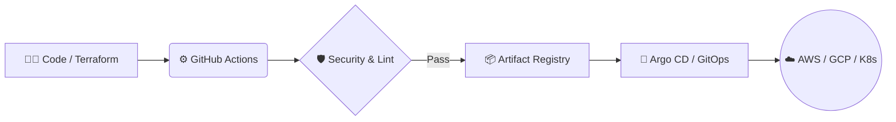

<div align="center">

  <!-- GIF iniziale -->
  

  <!-- Titolo dinamico (Typing SVG) -->
  <h1>
    
  </h1>

  <p>
    <em>Bridging the gap between development and operations through automation, scalable cloud architectures, and resilient CI/CD pipelines.</em>
  </p>

</div>

---

### 💻 `$ kubectl get engineer dorjan-shurdhi -o yaml`

```yaml
apiVersion: architecture.devops.io/v1
kind: CloudEngineer
metadata:
  name: Dorjan Shurdhi
  role: Senior DevSecOps & Cloud Architect
spec:
  coreFocus:
    - Cloud-Native & Serverless CI/CD (GitHub Actions, Argo CD)
    - Infrastructure as Code (Terraform, Ansible)
    - Container Orchestration & Kubernetes Ecosystems
    - Observability, FinOps & DevSecOps Automation
  philosophy: "If you have to do it twice, automate it. If it's not in Git, it doesn't exist."
```

---

### 🔄 My DevSecOps & GitOps Workflow



---

### 🏆 Certifications

<div align="center">


</div>

---

### 🛠️ Tech Stack & Tools

<div align="center">

#### ☁️ Cloud Providers & PaaS


#### ⚙️ Containers, Orchestration & IaC


#### 🔄 CI/CD, GitOps & Build


#### 📊 Monitoring & Observability


#### 🗄️ Databases


#### 🔀 Version Control & Project Management


</div>

---

### 📈 GitHub Stats & Activity

<div align="center">
  <a href="https://github.com/dorjanshurdhi">
    
  </a>
  <a href="https://github.com/dorjanshurdhi">
    
  </a>
</div>

<br/>

<div align="center">
  <!-- Serpente animato generato dalla GitHub Action -->
  <picture>
    <source media="(prefers-color-scheme: dark)" srcset="https://raw.githubusercontent.com/dorjanshurdhi/dorjanshurdhi/output/github-contribution-grid-snake-dark.svg" />
    <source media="(prefers-color-scheme: light)" srcset="https://raw.githubusercontent.com/dorjanshurdhi/dorjanshurdhi/output/github-contribution-grid-snake.svg" />
    
  </picture>
</div>

---

### 🤝 Connect with Me

<div align="center">
  <a href="https://www.linkedin.com/in/dorjanshurdhi/" target="_blank">
    
  </a>
</div>
